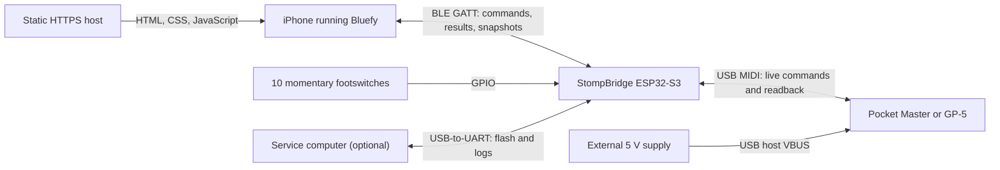
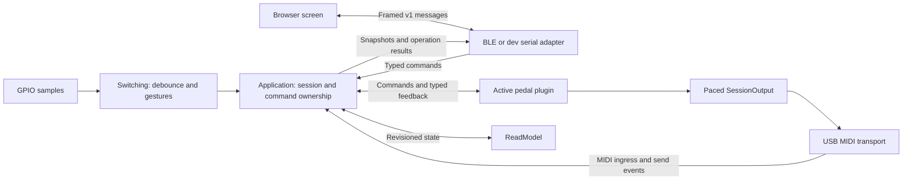
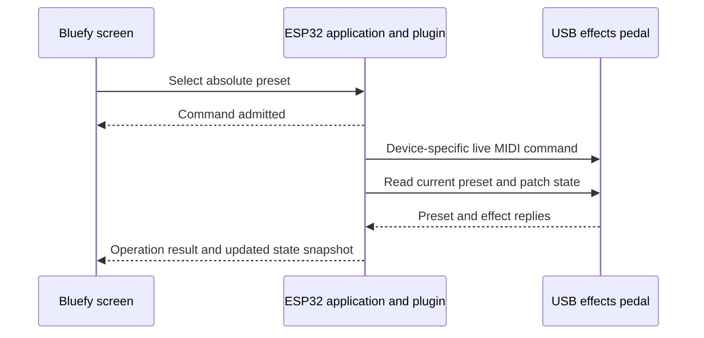

# StompBridge architecture

The POC runs in the `stompbridge-next-ble-ui` environment. The ESP32 owns the
active pedal session and provides two ways to control it, the physical
switches and a browser screen. Both send the same kinds of commands into the
firmware. The pedal is the source for confirmed preset and effect state.

## System connections

The phone talks to a custom GATT service on the ESP32. The ESP32 is the USB
host for the effects pedal. The HTTPS server only delivers the page assets.
The [hardware guide](hardware.md) maps these links to connectors, power, and
GPIOs.

## Firmware boundaries

| Area | Start reading here |
| --- | --- |
| GPIO sampling and USB event handoff | [next_usb_main.cpp](../src/next_usb_main.cpp) and [switching.cpp](../src/core/switching.cpp) |
| Application and state ownership | [application.cpp](../src/core/application.cpp), [contracts.h](../src/core/contracts.h), and [read_model.cpp](../src/core/read_model.cpp) |
| USB identity and device-specific MIDI | [registry.cpp](../src/devices/registry.cpp), [Pocket Master plugin](../src/devices/pocket_master/plugin.cpp), and [GP-5 plugin](../src/devices/gp5/plugin.cpp) |
| USB transport and output pacing | [usb_midi_transport.cpp](../src/usb_midi_transport.cpp) and [session_output.cpp](../src/core/session_output.cpp) |
| GATT, command validation, and snapshot framing | [ui_ble_server.cpp](../src/platform/ui_ble_server.cpp), [live_ingress.cpp](../src/ui/live_ingress.cpp), and the [BLE v1 contract](ble-ui-contract-v1.md) |
| Browser rendering and transport | [app.js](../ui/app.js), [ble_transport.js](../ui/ble_transport.js), and [serial_transport.js](../ui/serial_transport.js) |

The USB adapter passes copied MIDI and transport events through a bounded
queue. The application loop owns the active plugin, output schedule, and
read model. A session generation identifies the current USB attachment.
Disconnect or receive loss invalidates state certainty, and old-generation
events are discarded. BLE tracks a separate UI epoch so stale browser
commands cannot cross into a new UI session. The output queue gives live
commands priority over background requests such as fetching preset names.

## How two-way USB sync works

1. The USB registry matches the pedal's VID/PID and instantiates its plugin.
   Initial sync reads the current preset, reads its live effect state, then
   reads the preset again. Matching preset replies bracket the state read. Malformed or incomplete
   responses leave sync unconfirmed.
2. Each plugin validates its own protocol. Pocket Master assembles an ordered
   live-state response. The GP-5 decodes a patch-state fragment for on/off
   values and assembles separate fragments for model IDs. Each plugin fetches
   the 100-entry preset-name directory in the background and publishes names
   after validating the complete directory.
3. A footswitch or the phone submits a semantic action such as selecting
   an absolute preset or setting an effect. The plugin turns that action
   into device-specific MIDI and requests state after preset and block
   changes.
4. The application publishes verified feedback to the read model. Confirmed
   preset state aligns the local four-preset bank. The browser receives a
   new snapshot and renders the preset, effects, and certainty.

**Accepted** means the command entered the application. **Assumed** means
the transport completed a change whose state has yet to be verified.
**Confirmed** requires matching device feedback. **Unknown** covers values
currently lacking usable state. The tuner remains assumed after a successful
send, since the plugins lack reliable tuner readback.

## Build on the design

- Bring up switches, USB enumeration, and pedal readback independently with
  `stompbridge-next-input` and `stompbridge-next-usb` before adding a screen.
- For a new pedal, start with a verified USB descriptor and read-only request
  and response captures. Implement the device-specific plugin and capabilities
  behind the existing commands. Check readback against the pedal display over
  fresh boots, live changes, and reconnects.
- For another screen client, start with the [BLE v1 contract](ble-ui-contract-v1.md).
  Keep the browser's pending results and certainty tied to what the controller
  reports. The [USB development path](development.md) can exercise the same
  state and command path from a desktop.

The [support matrix](support-matrix.md) records which combinations were
demonstrated. The [USB parity audit](usb-parity-matrix.md) compares the earlier
default firmware with the replacement USB core.
